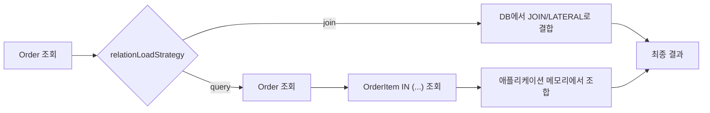
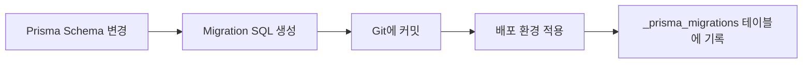
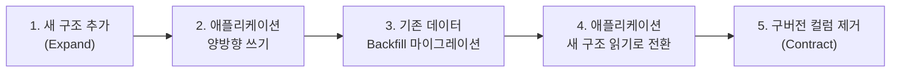

# 치킨집 관리 서버 (Day 4 Prisma 스터디)

저번 주(`day-3-nestjs`)의 파일 기반(`chickens.json`) 서버에서 **PostgreSQL 데이터베이스와 Prisma ORM v7**로 전환하고, 실제 서비스 개발에서 반드시 마주치게 되는 데이터베이스 동시성, 관계 로딩, 트랜잭션, 마이그레이션 문제를 다룹니다.

> 참고 자료: [Prisma ORM 7 공식 문서](https://www.prisma.io/docs/orm/v7) · [Coming from Prisma ORM 7](https://www.prisma.io/docs/orm/coming-from-prisma-orm-7)

---

## 목차
1. [실행하기](#실행하기)
2. [핵심 학습 내용 (Prisma v7)](#핵심-학습-내용-prisma-v7)
   - [1. findUniqueOrThrow: 데이터가 없으면 null로 끝내야 할까?](#1-finduniqueorthrow-데이터가-없으면-null로-끝내야-할까)
   - [2. 관계 데이터와 N+1 문제](#2-관계-데이터와-n1-문제)
   - [3. relationLoadStrategy: join vs query](#3-relationloadstrategy-join-vs-query)
   - [4. 여러 작업을 하나로: 트랜잭션 ($transaction)](#4-여러-작업을-하나로-트랜잭션-transaction)
   - [5. 동시성 문제와 Atomic Update](#5-동시성-문제와-atomic-update)
   - [6. 낙관적 동시성 제어 (OCC, Optimistic Concurrency Control)](#6-낙관적-동시성-제어-occ-optimistic-concurrency-control)
   - [7. 페이지네이션: Offset vs Cursor](#7-페이지네이션-offset-vs-cursor)
   - [8. 필요한 데이터만 가져오기: select vs omit](#8-필요한-데이터만-가져오기-select-vs-omit)
3. [Prisma Migrate 완벽 이해하기](#prisma-migrate-완벽-이해하기)
   - [마이그레이션 이력 관리](#마이그레이션-이력-관리)
   - [migrate dev vs migrate deploy](#migrate-dev-vs-migrate-deploy)
   - [Schema Drift와 Shadow Database](#schema-drift와-shadow-database)
   - [db push vs migrate dev](#db-push-vs-migrate-dev)
   - [무중단 스키마 변경: Expand and Contract 패턴](#무중단-스키마-변경-expand-and-contract-패턴)
4. [Prisma v8 (Release Candidate) 비교](#prisma-v8-release-candidate-비교)
5. [API 목록](#api-목록)
6. [API 테스트 (Bruno)](#api-테스트-bruno)
7. [자동화 테스트 (Unit & E2E)](#자동화-테스트-unit--e2e)

---

## 실행하기

### 1. PostgreSQL 데이터베이스 실행
Docker Compose로 로컬 데이터베이스를 구동합니다.
```bash
docker compose up -d
```

### 2. 패키지 설치 및 마이그레이션 적용
```bash
pnpm install

# 마이그레이션 적용 (init 및 add_spicy_level 이력 적용)
pnpm run prisma:deploy

# 마이그레이션 상태 확인
pnpm run prisma:status

# 초기 시드 데이터 주입 (치킨 5곳, 주문 15건)
pnpm run prisma:seed
```

### 3. 서버 실행
```bash
pnpm run start:dev   # http://localhost:3000
```

### 4. 테스트 실행
```bash
pnpm test            # Unit Test (Service 단위 테스트)
pnpm run test:e2e    # E2E Test (실제 DB 연결 E2E 테스트)
```

---

## 핵심 학습 내용 (Prisma v7)

### 1. findUniqueOrThrow: 데이터가 없으면 null로 끝내야 할까?
기본 `findUnique()`는 데이터가 없으면 `null`을 반환하므로, 서비스 계층마다 다음과 같은 코드가 반복됩니다:
```ts
const chicken = await prisma.chicken.findUnique({ where: { id: chickenId } });
if (!chicken) {
  throw new NotFoundException('해당 치킨집 정보가 존재하지 않습니다.');
}
```
`findUniqueOrThrow()`는 데이터가 없을 때 즉시 예외(`NotFoundError`, 코드 `P2025`)를 발생시키며 반환 타입도 nullable이 아닙니다:
```ts
const chicken = await prisma.chicken.findUniqueOrThrow({
  where: { id: chickenId },
});
```
"이 id의 치킨집은 반드시 존재해야 한다"는 서비스의 전제조건을 간결하고 명확하게 드러냅니다. (발생한 `P2025` 에러는 `PrismaClientExceptionFilter`가 자동으로 404 HTTP 응답으로 변환합니다.)

---

### 2. 관계 데이터와 N+1 문제
치킨집 주문 시스템에서는 다음과 같은 관계가 존재합니다:
```
Chicken (치킨)
  └── Order (주문)
        └── OrderItem (주문 상품)
```

#### N+1 문제란?
주문 목록 100개를 가져온 뒤 루프를 돌며 각 주문의 주문 상품을 다시 조회하면:
- 주문 목록 조회: **1번**
- 각 주문별 상품 조회: **100번**
- **총 101번의 쿼리**가 데이터베이스에 전송됩니다.

```ts
// ❌ N+1 문제 발생 코드
const orders = await prisma.order.findMany(); // 1번
for (const order of orders) {
  const items = await prisma.orderItem.findMany({ where: { orderId: order.id } }); // N번
}
```

#### 해결 방법
Prisma의 `include` 또는 `select`를 사용하여 한 번에 연관 관계를 가져옵니다:
```ts
// ✅ 효율적인 관계 조회
const orders = await prisma.order.findMany({
  include: {
    items: {
      include: {
        chicken: true,
      },
    },
  },
});
```

---

### 3. relationLoadStrategy: join vs query
Prisma v7에서는 관계 데이터를 가져올 때 데이터베이스 레벨의 전략을 지정할 수 있습니다:



```ts
const orders = await prisma.order.findMany({
  relationLoadStrategy: 'join', // 또는 'query'
  include: {
    items: true,
  },
});
```
- **`join`**: PostgreSQL의 `LEFT JOIN` / `LATERAL`을 사용해 단일 쿼리로 결합합니다. 네트워크 왕복이 줄어들지만 대량 1:N 조인 시 중복 데이터 전송량이 늘어날 수 있습니다.
- **`query`**: 부모 쿼리와 자식 쿼리(`WHERE IN (...)`)를 나누어 보낸 후 Node.js 메모리에서 조합합니다.
- 데이터의 양과 인덱스 상황에 따라 실행 계획(EXPLAIN ANALYZE)을 보고 최적의 전략을 선택합니다.

---

### 4. 여러 작업을 하나로: 트랜잭션 ($transaction)
치킨 주문이 발생하면 다음 작업들이 동시에 일어나야 합니다:
1. 치킨 재고 확인
2. 치킨 재고 차감
3. 주문(Order) 레코드 생성
4. 주문 상세 항목(OrderItem) 레코드 생성

중간에 재고가 부족하거나 에러가 났는데 앞선 작업이 커밋된다면 데이터 정합성이 깨집니다.

```ts
await prisma.$transaction(async (tx) => {
  // 1. 재고 확인 및 원자적 차감
  const chicken = await tx.chicken.findUniqueOrThrow({ where: { id: chickenId } });
  if (chicken.stock < quantity) {
    throw new BadRequestException('재고가 부족합니다.');
  }

  await tx.chicken.update({
    where: { id: chickenId },
    data: { stock: { decrement: quantity } },
  });

  // 2. 주문 생성
  const order = await tx.order.create({
    data: {
      customerId,
      totalPrice: chicken.price * quantity,
      items: {
        create: [{ chickenId, quantity, price: chicken.price }],
      },
    },
  });

  return order;
});
```
- 블록 안에서 에러가 던져지면 모든 변경 사항이 자동으로 **ROLLBACK**됩니다.
- 트랜잭션 내부에는 외부 API 호출 등 지연을 유발하는 코드를 넣지 않습니다 (DB 커넥션 점유 최소화).

---

### 5. 동시성 문제와 Atomic Update
두 손님이 동시에 남은 재고 1마리의 치킨을 주문하면, 둘 다 "재고 1마리 있음"으로 판단하여 둘 다 성공해 버리는 **Lost Update (Race Condition)**가 발생할 수 있습니다.

```ts
// ✅ DB 레벨 원자적 차감
await prisma.chicken.update({
  where: { id: chickenId },
  data: {
    stock: {
      decrement: quantity,
    },
  },
});
```
애플리케이션 메모리에서 읽고 계산한 뒤 덮어쓰는 대신, PostgreSQL 자체의 `UPDATE "Chicken" SET stock = stock - quantity` 원자적 연산을 활용합니다.

---

### 6. 낙관적 동시성 제어 (OCC, Optimistic Concurrency Control)
충돌이 드물게 발생하지만 반드시 막아야 하는 정보 수정에는 `version` 컬럼을 둡니다:

```prisma
model Chicken {
  id      Int @id @default(autoincrement())
  version Int @default(0)
  // ...
}
```

```ts
// 수정 시 내가 읽었던 version 번호와 일치하는 경우에만 업데이트
const result = await prisma.chicken.updateMany({
  where: {
    id: chickenId,
    version: expectedVersion,
  },
  data: {
    price: newPrice,
    version: { increment: 1 },
  },
});

if (result.count === 0) {
  throw new ConflictException('다른 사용자에 의해 데이터가 변경되었습니다. 최신 데이터를 확인해주세요.');
}
```

---

### 7. 페이지네이션: Offset vs Cursor

#### Offset Pagination
- 쿼리: `skip: 100000, take: 20`
- 문제점: 앞의 10만 개 레코드를 DB가 실제로 읽고 버려야 하므로 뒤로 갈수록 쿼리가 급격히 느려집니다.

#### Cursor Pagination
- 쿼리: `take: 20, skip: 1, cursor: { id: lastSeenId }, orderBy: { id: 'asc' }`
- 장점: 인덱스를 활용해 "이 ID 다음부터 20개"를 즉시 찾으므로 아무리 페이지가 깊어져도 응답 속도가 일정합니다.

---

### 8. 필요한 데이터만 가져오기: select vs omit
- **`select`**: "이 필드들만 가져와줘"
  ```ts
  const chickens = await prisma.chicken.findMany({
    select: { id: true, name: true, price: true },
  });
  ```
- **`omit`**: "기본적으로 다 가져오되, 이 필드만 빼줘"
  ```ts
  const chickens = await prisma.chicken.findMany({
    omit: { createdAt: true, updatedAt: true },
  });
  ```

---

## Prisma Migrate 완벽 이해하기

### 마이그레이션 이력 관리
Prisma Migrate는 스키마의 변경 역사를 코드(`prisma/migrations/`)와 데이터베이스(`_prisma_migrations` 테이블) 양쪽에 기록합니다.



이 프로젝트는 2단계 마이그레이션으로 구성되어 있습니다:
1. `20261004120000_init`: `Chicken`, `Order`, `OrderItem` 초기 생성
2. `20261004130000_add_spicy_level`: `Chicken` 테이블에 `spicyLevel` 컬럼 추가

### migrate dev vs migrate deploy
- **개발 환경 (`pnpm run prisma:migrate` / `prisma migrate dev`)**:
  - `schema.prisma` 변경점을 감지하여 새 SQL 마이그레이션 파일을 생성하고 개발 DB에 적용합니다.
  - Shadow Database를 활용해 스키마 유효성을 검증합니다.
- **운영/배포 환경 (`pnpm run prisma:deploy` / `prisma migrate deploy`)**:
  - 새 마이그레이션 파일을 생성하지 않고, **이미 Git에 커밋된 마이그레이션 파일들 중 DB에 아직 적용되지 않은 것만 순서대로 실행**합니다.

### Schema Drift와 Shadow Database
누군가 DB 콘솔에 직접 접속해 테이블이나 컬럼을 수동으로 변경하면, Git의 마이그레이션 이력과 실제 DB 상태가 달라집니다. 이를 **Schema Drift**라고 부릅니다.
`prisma migrate dev`는 임시 DB(Shadow DB)를 생성하여 처음부터 마이그레이션을 돌려본 뒤 개발 DB와 상태를 비교함으로써 Schema Drift를 감지합니다.

### db push vs migrate dev
- `prisma db push`: 마이그레이션 히스토리 파일을 남기지 않고 스키마를 DB에 즉시 강제 반영합니다. (초기 프로토타이핑용)
- `prisma migrate dev`: 변경 이력을 SQL 파일로 남겨 팀원 및 운영 환경과 동일한 변경 과정을 공유합니다. (프로덕션 필수)

### 무중단 스키마 변경: Expand and Contract 패턴
운영 중인 DB에 이미 데이터가 수십만 건 있을 때, 필수 컬럼을 추가하거나 컬럼명을 변경하면 구버전 서버와의 호환성이 깨질 수 있습니다.



---

## Prisma v7 & v8 동시 지원 및 비교

이 프로젝트는 [공식 Prisma 7 to 8 PostgreSQL 점진적 업그레이드 가이드](https://github.com/prisma/docs/blob/main/apps/docs/content/docs/guides/upgrade-prisma-orm/postgresql.mdx)에 따라 구성되어 있습니다.
Prisma v7과 v8을 분리된 프로젝트가 아닌 **동일한 서비스와 API 엔드포인트에서 나란히 구동**하여, 개발자가 실시간으로 문법과 동작을 비교할 수 있습니다.

### 듀얼 아키텍처 구성 방식
1. **Prisma 7 (`@prisma/prisma7` & `@prisma/client`)**:
   - `prisma7.config.ts`: Prisma 7 설정 파일 (`prisma/schema.prisma` 참조)
   - CLI 명령어: `pnpm exec prisma7 generate`, `pnpm exec prisma7 migrate deploy`
2. **Prisma 8 (`prisma@8.0.0-rc.14` & `@prisma/orm-postgres`)**:
   - `prisma.config.ts`: Prisma 8 설정 파일 (`prisma/contract.prisma` 참조)
   - CLI 명령어: `pnpm exec prisma contract emit` -> `generated/prisma8/contract.json` & `contract.d.ts` 생성
   - 런타임: `postgres<Contract>({ url, contractJson })` (`@prisma/orm-postgres/runtime`)을 `PrismaV8Service`에서 인스턴스화하여 실제 PostgreSQL 데이터베이스 쿼리 수행

| 주제 | Prisma v7 (현재 프로젝트) | Prisma v8 (동시 제공 `/v8`) |
| --- | --- | --- |
| **스키마/계약서** | `prisma/schema.prisma` | `prisma/contract.prisma` |
| **datasource/generator** | 스키마 내부에 선언 | `prisma.config.ts`로 완전 분리 |
| **클라이언트 생성** | `pnpm exec prisma7 generate` | `pnpm exec prisma contract emit` |
| **전체 조회** | `prisma.chicken.findMany()` | `db.orm.public.Chicken.all()` |
| **단건 조회 예외** | `findUniqueOrThrow()` | `.where(...).all().firstOrThrow()` |
| **단건 생성** | `create({ data: { ... } })` | `create({ ... })` (data 래퍼 제거) |
| **대량 삽입** | `createMany({ skipDuplicates: true })` | `createAll(..., { onConflict: 'skip' })` |
| **삽입 개수** | `createMany()`의 `{ count }` | `createAndCount()` |
| **페이지네이션** | `findMany({ skip, take })` | `offset(skip).limit(take).all()` |
| **관계 로딩** | `include: { items: { include: { chicken: true } } }` | `.include('items', (i) => i.include('chicken', (c) => c))` |
| **트랜잭션** | `prisma.$transaction(async (tx) => ...)` | `db.transaction(async (tx) => ...)` |
| **Raw SQL** | `$queryRaw` / `$executeRaw` | `db.sql.public.<table...>` (SQL builder) |
| **PostgreSQL Enum** | `enum ChickenType` (DB enum 타입 생성) | `native_enum` + `pg.enum()` (일반 enum은 text 저장) |
| **마이그레이션** | `migrate dev` / `migrate deploy` | `contract emit` -> `migration plan` -> `db verify` |

---

## API 목록

변경 API(POST/PATCH/DELETE)는 `x-api-key: chicken-admin-key` 헤더가 필요합니다.

### 치킨 API (`/chicken`) - v7 & v8 병행
| 메서드 | 경로 | 설명 | Guard | 실습 비교 |
| --- | --- | --- | --- | --- |
| GET | `/chicken` | 치킨 목록 조회 (v7) | - | `prisma.chicken.findMany()` (offset/cursor, select/omit) |
| GET | `/chicken/v8` | 치킨 목록 조회 (v8) | - | `db.orm.public.Chicken.offset().limit().all()` |
| GET | `/chicken/:id` | 치킨 단건 조회 (v7) | - | `findUniqueOrThrow()` |
| GET | `/chicken/:id/v8` | 치킨 단건 조회 (v8) | - | `where({ id }).all().firstOrThrow()` |
| POST | `/chicken` | 신규 치킨 등록 (v7) | ✅ | `create({ data: { ... } })` |
| POST | `/chicken/v8` | 신규 치킨 등록 (v8) | ✅ | `create({ ... })` (data 래퍼 없이 직접 전달) |
| POST | `/chicken/batch` | 치킨 대량 등록 (v7) | ✅ | `createMany({ skipDuplicates: true })` |
| POST | `/chicken/batch/v8` | 치킨 대량 등록 (v8) | ✅ | `createAndCount(..., { onConflict: 'skip' })` |
| PATCH | `/chicken/:id` | 치킨 정보 수정 | ✅ | `update()` |
| PATCH | `/chicken/:id/stock` | 재고 원자적 수정 | ✅ | Atomic decrement (`stock: { decrement }`) |
| PATCH | `/chicken/:id/occ` | 낙관적 락 정보 수정 | ✅ | OCC 버전 증가 및 409 Conflict |
| DELETE | `/chicken/:id` | 치킨 삭제 | ✅ | `delete()` |

### 주문 API (`/order`) - v7 & v8 병행
| 메서드 | 경로 | 설명 | Guard | 실습 비교 |
| --- | --- | --- | --- | --- |
| POST | `/order` | 치킨 주문 생성 | ✅ | `$transaction`, 재고 차감 및 롤백 |
| GET | `/order` | 주문 목록 조회 (v7) | - | Cursor / Offset 페이지네이션 |
| GET | `/order/v8` | 주문 목록 조회 (v8) | - | `db.orm.public.Order.offset().limit().all()` |
| GET | `/order/:id` | 주문 상세 조회 (v7) | - | 중첩 `include: { items: { chicken } }` |
| GET | `/order/:id/v8` | 주문 상세 조회 (v8) | - | `db.orm.public.Order.where({ id }).all().firstOrThrow()` |
| GET | `/order/study/n-plus-one` | N+1 문제 시뮬레이션 | - | 1+N 쿼리 발생 현상 확인 |
| GET | `/order/study/strategy` | 관계 로딩 전략 비교 | - | `relationLoadStrategy` ('join' vs 'query') |

---

## API 테스트 (Bruno)

`chicken-project/bruno/chicken-api/` 컬렉션을 통해 전체 API를 GUI 또는 CLI로 테스트할 수 있습니다.

```bash
# 컬렉션 폴더로 이동하여 전체 실행
bru run chicken-project/bruno/chicken-api

# 주문 및 트랜잭션 테스트 폴더 실행
bru run -r "06-주문 및 트랜잭션" chicken-project/bruno/chicken-api
```

---

## 자동화 테스트 (Unit & E2E)

```bash
# 1. 단위 테스트 (Service 레이어 21개 케이스 100% 통과)
pnpm test

# 2. E2E 테스트 (실제 PostgreSQL 연동 27개 케이스 100% 통과)
pnpm run test:e2e
```
